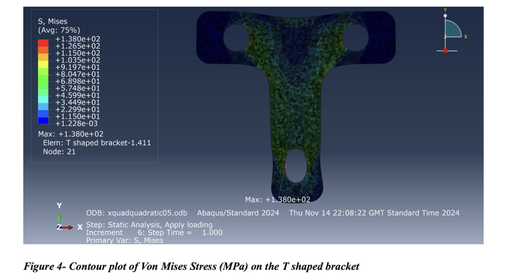
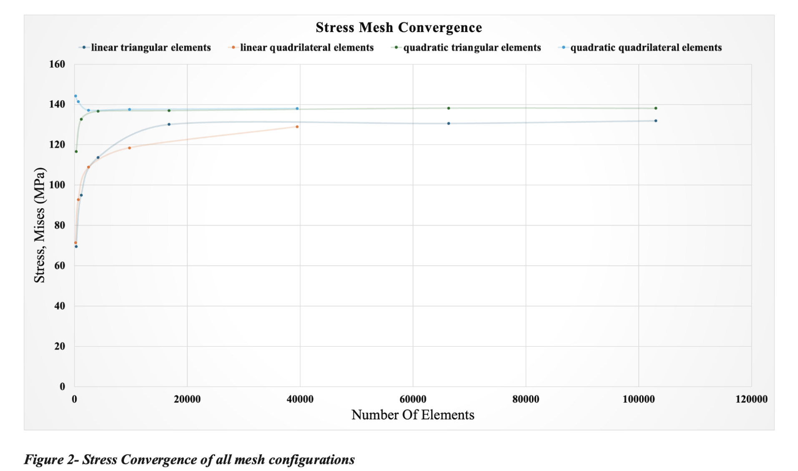
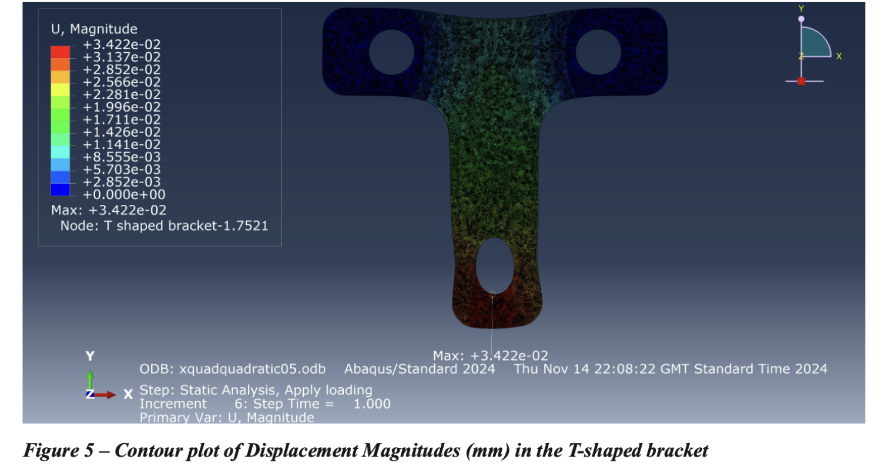

# Finite Element Analysis of a Steel T-Bracket

Where does a steel bracket holding up a timber beam fail first, and how fine does your mesh need to be before you can trust the answer?

**Individual coursework · Simulation Tools in Engineering Analysis and Design · Queen Mary University of London, 2024–25**

## What I did

I modelled a 2D mild-steel T-bracket in Abaqus, sized like a standard bracket used to join timber columns to beams. I fixed the two bolt holes on the horizontal flange and applied a 9,810 N load (about 250 kg) to the bottom bolt hole, which works out at 31.23 MPa of surface traction.

Then I ran a mesh convergence study. Starting from an 8 mm mesh, I halved the element size each step down to 0.4 mm, using four element types: linear and quadratic, triangular and quadrilateral.

## What went wrong

The coarse linear meshes badly underestimated the stress. Linear triangles at 8 mm gave about 70 MPa, roughly half the converged value. That's the whole reason for a convergence study: a model can run without errors and still be wrong. I also couldn't take the quadrilateral meshes below 0.5 mm because of student licence limits, so those results stop one step early.

## Results

- Peak von Mises stress converged to about **138 MPa**, and displacement to about **0.0342 mm**.
- Stress concentrated around the bolt holes and the fillets where the flange meets the stem, with the maximum at the loaded bottom hole. That's where the bracket would fail first.
- Quadratic quadrilateral elements (CPS8R) gave the most consistent results, even on coarse meshes.

## Tools

Abaqus · Excel

## Files

- [Full report](./finite-element-analysis-t-bracket-report.pdf)
